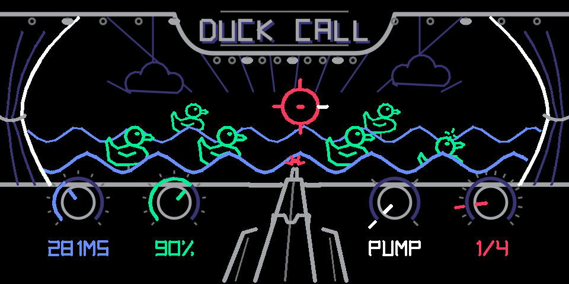

# Duck Call

**OP-1 filter. Sidechain, gate and choke for the OP-1 on hundekraft.**

Something hits, and your sound ducks out of the way, or opens up only on the hit. Duck Call is an effect plugin for the [hundekraft](https://hundekraft.github.io/op1-workshop/) firmware, inspired by Befaco's PercAll. Its screen is an early 20th-century carnival duck shoot: every hit knocks rubber ducks down, and the curtains, waves, rifle and sight show your settings.

**[Play the demo](https://ssimorka.github.io/duck-call/)** · **[Read the manual](docs/MANUAL.md)** · **[Download `duckcall.knl`](https://github.com/ssimorka/duck-call/raw/main/duckcall.knl)**

## Put it on your OP-1

You need an OP-1 running hundekraft 3.2 or later.

1. Download [`duckcall.knl`](https://github.com/ssimorka/duck-call/raw/main/duckcall.knl) (it is also at the top of this repo).
2. Open the [hundekraft workshop](https://hundekraft.github.io/op1-workshop/) in Chrome.
3. Go to **Your plugins** and choose **Add your plugin files**. Pick `duckcall.knl`.
4. Choose **Connect my OP-1**, then **Review changes**, then **Send**.
5. Press **T1** on the OP-1 when it asks.

Duck Call now shows up in the FX list of any synth, the drums and the master. To update, do the same with a newer file. Your sounds keep their settings.

## The controls

| Knob | Turn | Press |
| --- | --- | --- |
| Blue | Length, 15 ms to 2 s | Page 2: attack, 0.2 to 100 ms |
| Green | Strength | Page 2: accent (beat sources) or sensitivity (audio sources) |
| White | Shape: pump, linear, hold, choke | Page 2: flip, from duck through flat to gate |
| Red | Source: 1/1 to 1/16T, T1 to T4, tape, in, self, inst | Choke on or off |

The [manual](docs/MANUAL.md) covers every control, the screen, recipes and tips.

## The demo

The [web demo](https://ssimorka.github.io/duck-call/) runs the same Duck Call logic in your browser, with the OP-1 screen, the knobs and a built-in Rhythm Machine. Pick a genre and its beat plays on the four tape tracks (T1 kick, T2 open hats, T3 snares, T4 hats and percussion), loads a matching Duck Call recipe, and drives a pad. Click steps to change the beat.

## Build it yourself

The plugin source is in [`plugin/`](plugin). It builds with the hundekraft plugin SDK and a Blackfin GCC toolchain (`bfin-elf-gcc`).

1. Get the hundekraft source and copy `plugin/` to `ext/kennel/synth_sdk/plugins/duckcall/`.
2. With `bfin-elf-gcc` on your `PATH`, run from `ext/kennel`:
   `python3 tools/kennel/pack.py synth_sdk/plugins/duckcall -o duckcall.knl`
3. The screen art is generated: `python3 gen_screen.py` writes `duckcall.svg` and `duckcall_geom.h`.

| File | What it is |
| --- | --- |
| `duckcall.c` | The effect: hit detection, beat grid, envelope, duck/gate, choke |
| `duckcall_screen.c` | The animated screen, drawn as lines each frame |
| `gen_screen.py` | Generates the still art (`duckcall.svg`) and the moving parts' geometry (`duckcall_geom.h`) |
| `plugin.json` | Name, knob defaults, screen |

## Credits

Designed by Steph Simorka. Built on [hundekraft](https://hundekraft.github.io/op1-workshop/)'s kennel plugin SDK. Inspired by [Befaco PercAll](https://befaco.org/docs/Percall/Percall_V1_User_Manual.pdf). The demo's beats come from Rhythm Machine's genre library.

Not affiliated with or endorsed by teenage engineering, hundekraft or Befaco.

## Support

Duck Call is free and made for fun. If you enjoy it, you can [buy me a coffee on Ko-fi](https://ko-fi.com/stephsimorka).

## License

GPL-3.0-or-later with the OP-1 firmware permission, the same terms as hundekraft's kennel. See [LICENSE](LICENSE) and [NOTICE](NOTICE).
