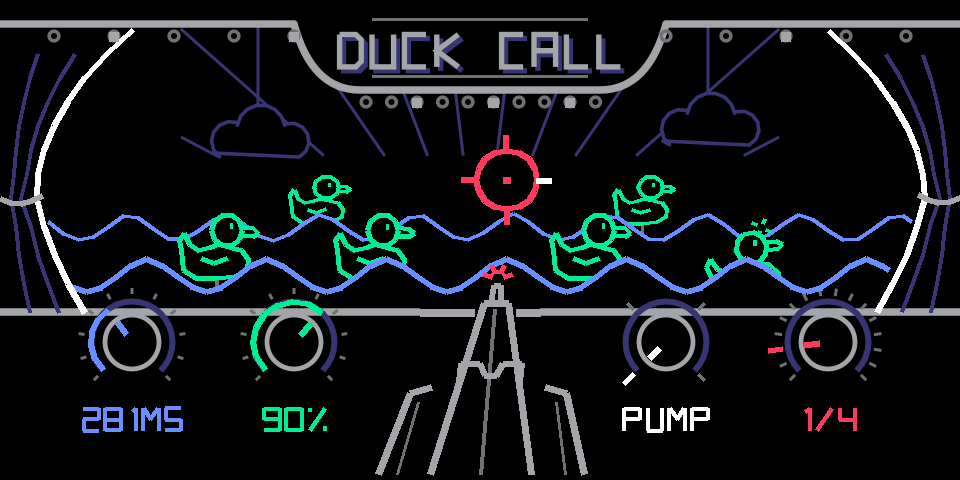

# Duck Call: Manual

*Sidechain, gate and choke. Step right up.*

Duck Call is an effect for the OP-1 on hundekraft. Something hits, and your sound dips out of the way (duck), or opens up only on the hit (gate). The hits come from the beat grid, a tape track, the input, or the sound itself. It is modeled on Befaco's PercAll, a Eurorack module of decay envelopes, VCAs and choke switches.

The screen is an early 20th-century carnival duck shoot. Every hit knocks rubber ducks down, the rifle fires on the beat, and the curtains, waves and sight show your settings. You can read the whole effect at a glance.

## Install

Duck Call is one file, `duckcall.knl`. It needs hundekraft 3.2 or later on the OP-1.

1. Download [`duckcall.knl`](https://ssimorka.github.io/duck-call/duckcall.knl).
2. Open the [hundekraft workshop](https://hundekraft.github.io/op1-workshop/) in Chrome.
3. Go to the **Your plugins** tab and choose **Add your plugin files**. Pick `duckcall.knl`.
4. Choose **Connect my OP-1**, then **Review changes**, then **Send**.
5. When the OP-1 asks, press **T1** to install.

**Load:** open the FX screen of a synth, the drums or the master, and pick **duckcall** from the effects.

To update, add the new `duckcall.knl` the same way. A file with the same name replaces the old one, and your sounds keep their settings.

## The screen

Every part of the scene is tied to a knob, in that knob's color. The scene moves while sound comes through or the tape runs. In silence it holds still.

*Fig. 1: just after a hit on beat 2 at 1/4. A front duck is going down with green ricochet dashes, the rifle's muzzle flash is still lit, and the sight's tick for that beat is white.*

| Part | What it shows |
| --- | --- |
| Ducks (green) | Each hit knocks ducks down for as long as the dip lasts. The 1 of the bar takes the back pair. Other hits take turns along the front row. A down duck turns indigo and sinks. |
| Green dashes | A ricochet over each duck that goes down. |
| Wobble and dodge | Standing ducks wobble on every hit. They duck their heads on a miss (a hit under the sensitivity). |
| Waves (blue) | Attack. Sharp, choppy waves for a short attack, rounded swells for a long one. They roll faster with a shorter length. |
| Curtains (white) | Shape. The inner edge of the curtains draws the curve: pump, linear, hold or choke. |
| Rifle | Flip. It aims left for gate, center for flat, right for duck. It turns white while you're on white's page 2. |
| Muzzle flash (red) | Fires on every hit. Bigger on the 1. |
| Sight (red) | Source. Each source has its own sight (see Sources). Beat sources light the tick of the pulse that fired. Track and input sights flash white on a hit. A red X means a choke just landed. |
| Marquee bulbs | Chase one step on every hit. All light up on the 1. |
| Knobs | A fill or pointer for each value, with the value in words below it. |
| Page 2 | A ring inside the knob, and the value on a chip of the knob's color. |

On white's page 2 (flip), the white arc grows from the top of the knob: left toward gate, right toward duck.

## Controls

Push blue, green or white for page 2. Push red to switch choke on. Page 2 settings are saved with the sound. The choke switch is not, so it starts off each time you load the sound.

| Knob | Control | Range | Default | What it does |
| --- | --- | --- | --- | --- |
| Blue | **Length** | 15 ms to 2 s | 281 ms | How long a full-strength dip (or gate) lasts. Softer hits last less, down to a quarter of this. |
| Blue, page 2 | **Attack** | 0.2 to 100 ms | 3 ms | How fast the level moves into the dip and back. Short is a hard, punchy cut. Long is a swell. |
| Green | **Strength** | 12 to 100% | 89% | How deep each dip goes, and how long it lasts (PercAll's strength). Deep from the middle of the knob up. 100% goes to silence. |
| Green, page 2 | **Accent** (beat sources) | 0 to 100% | 50% | Softens every hit but the 1. At 0% all hits are equal. At 100% only the 1 is left. |
| Green, page 2 | **Sensitivity** (track, tape, input, self) | 0 to 100% | 50% | How loud a hit must be to count. Hits below it are misses. |
| White | **Shape** | Pump, Linear, Hold, Choke | Hold | The curve of each dip. Snaps to the four shapes. |
| White, page 2 | **Flip** | Gate to Flat to Duck | Duck | Duck dips on each hit. Gate is silent and opens on each hit. Flat in the middle does nothing. Between them is a blend. |
| Red | **Source** | 16 sources | 1/4 | What makes the hits. Snaps to the sources. |
| Red, push | **Choke** | On or off | Off | The partner track's hits cut the current dip or gate short. |

The values shown on screen are the real ones, so green's label reads the actual depth, not the knob position.

## Sources

Red picks what makes the hits. The first eight are the beat grid. The rest listen to audio.

| Source | Hits on | Sight |
| --- | --- | --- |
| 1/1, 1/2, 1/4, 1/8, 1/16 | Whole notes down to sixteenths, on the OP-1 tempo | A ring with a tick per pulse in the bar |
| 1/4T, 1/8T, 1/16T | Triplets | A ring with a tick per pulse |
| T1, T2, T3, T4 | A tape track's playback | A crosshair with one to four corner ticks |
| TAPE | All four tracks together | A ring with three spokes |
| IN | The audio input (mic or line) | A peak |
| SELF | The sound the effect is on | A small mic |
| INST | The instrument under the master FX (master only; elsewhere it acts as SELF) | A mic in a bracket |

**The beat grid** follows the tape while it plays and restarts with it. With the tape stopped it keeps running at the OP-1 tempo, so playing keys pumps on the grid too. Accent (green, page 2) shapes the bar: the 1 always hits at full strength, the beats come next, and the in-betweens are softest.

**Audio sources** listen for a jump in level after a quieter moment. Each hit's strength is its loudness in the first 10 ms, so a soft hit gives a shallow, short dip and a hard hit a deep, long one. After a hit, the detector waits 30 ms before it can fire again. A hit quieter than the sensitivity is a miss: nothing happens to the sound, and the ducks dodge. A hit that lands on the 1 of the bar knocks the back pair down, like a beat source.

## Duck, gate and the four shapes

Flip (white, page 2) sets what a hit does. Shape (white) sets the curve the level follows after it.

- **Duck:** the level drops on each hit, then comes back. The classic sidechain pump.
- **Gate:** the sound is silent until a hit opens it, then it closes again. Chops pads into rhythm.
- **Flat:** in the middle, hits do nothing. Turn slowly from duck through flat to gate to fade one into the other.

| Shape | In duck | In gate |
| --- | --- | --- |
| **Pump** | A quick dip that springs right back. The gentlest. | A short blip. |
| **Linear** | An even ramp back up. | An even fade out. |
| **Hold** | Stays down, then swells back. The big breathing pump. | Stays open, then fades. |
| **Choke** | Stays down almost to the end, then snaps open. | A clean slice that cuts off at the end. PercAll's choked hat. |

Attack (blue, page 2) rounds every corner of the curve, both into the dip and back out.

## Choke

Push red to switch choke on, the way PercAll's choke switches work. With choke on, a hit on the partner track ends the current dip or gate on the spot.

| Source | Choked by |
| --- | --- |
| T1 | T2 |
| T2 | T1 |
| T3 | T4 |
| T4 | T3 |
| Everything else | T1 |

Red's chip shows the pair, for example **T2 CUT T1**. When a choke lands, the sight is crossed out with a red X and the ducks react right away.

- **In gate:** the hi-hat trick. T2 opens the sound, a T1 hit slams it shut.
- **In duck:** a T1 hit lets the sound pop right back up.

The partner has to be a tape track that is playing back. The switch is not saved with the sound.

## Recipes

Starting points. Put Duck Call on the sound named in each row, then set the knobs.

| Recipe | On | Source | Length | Strength | Shape | Page 2 | Choke |
| --- | --- | --- | --- | --- | --- | --- | --- |
| **Classic pump** | Synth pad or chords | 1/4 | 300 to 400 ms | 70% | Hold | Attack 20 ms, Duck | Off |
| **Kick pump** | Synth bass | T1 (your kick) | 200 ms | 90% | Hold | Attack 3 ms, Sensitivity 50%, Duck | Off |
| **Trance gate** | Synth pad | 1/16 | 80 ms | 100% | Choke | Attack 1 ms, Gate | Off |
| **Triplet chop** | Synth chords | 1/8T | 120 ms | 100% | Linear | Gate | Off |
| **Bar breather** | Synth pad | 1/1 | 1.5 s | 100% | Hold | Attack 60 ms, Duck | Off |
| **Groove accents** | Synth pad | 1/8 | 200 ms | 90% | Hold | Accent 70%, Duck | Off |
| **Hi-hat choke** | Synth or drums | T2 (open hat) | 1 s | 100% | Hold | Gate | On (T1 closed hat) |
| **Talk-over** | Master | IN (mic) | 600 ms | 70% | Hold | Attack 40 ms, Sensitivity 30%, Duck | Off |
| **Self swell** | Synth lead | SELF | 400 ms | 100% | Linear | Attack 100 ms, Duck | Off |
| **Bounce back** | Synth pad | 1/4 | 1 s | 100% | Hold | Duck | On (T1) |

**Self swell** makes every new note dip and swell back in, like a reverse attack. **Bounce back** pumps on the grid, and a T1 hit lets the pad back in early.

## Tips and tricks

- **Duck shines on long sounds.** Pads, chords and bass show the pump best. On drums, the dip lands right on the hit, so you mostly hear the drums get quieter.
- **Duck too subtle?** Go to Hold or Choke, and push strength past 70%. Pump is the gentlest shape.
- **Gate is all-or-nothing.** Between hits the sound is silent, so a long length keeps more of it.
- **Short length and fast divisions stop the dip from finishing.** At 1/16 with a long length, each hit restarts the dip before the last one recovers, and the sound stays low. Shorten the length or slow the division.
- **Long attacks need room.** A 100 ms attack can't reach full depth on a 60 ms length.
- **Accent turns a grid into a groove.** On 1/8 or 1/16, push accent up until only the beats, then only the 1, come through.
- **Sensitivity is your filter.** On a busy track, raise it until only the loud hits duck. Ghost notes become misses, and the ducks dodge them.
- **The ducks tell you what's working.** If the ducks aren't going down, the hits are too soft or too short to make a real dip.
- **Flip is playable.** Sweep white's page 2 from duck through flat to gate during a take.
- **Keys pump with the tape stopped.** The beat grid keeps the OP-1 tempo, so you can jam without pressing play.
- **Use T1 for your kick.** Choke and the kick pump both expect the drums there.
- **SELF is a ducker for the sound itself.** Every new note dips it, a quick way to get swells and "backwards" attacks.

**What's saved with the sound:** all four knobs and the three page-2 settings. **Not saved:** the choke switch.

## Specs and credits

| | |
| --- | --- |
| Type | Stereo effect (synth, drums or master FX) |
| Needs | OP-1 with hundekraft 3.2 or later (on TE firmware R246) |
| File | `duckcall.knl`, about 36 KB |
| Sources | 16: eight beat divisions, T1 to T4, TAPE, IN, SELF, INST |
| Length | 15 ms to 2 s |
| Attack | 0.2 to 100 ms |
| Screen | 320 x 160, line art redrawn every frame over a fixed backdrop |

Designed by Steph Simorka. Built on the hundekraft plugin SDK. Inspired by [Befaco PercAll](https://befaco.org/docs/Percall/Percall_V1_User_Manual.pdf). Released under GPL-3.0-or-later with the OP-1 firmware permission.
